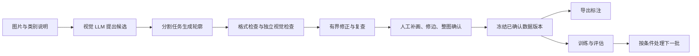

# Vision-Language Automated Annotation（VLAA）

[下载源码 ZIP](https://github.com/shengbei4980/VLAA/archive/refs/heads/main.zip) · [English](README.en.md) · [安装教程](docs/INSTALL.md) · [使用教程](docs/USER_GUIDE.md) · [本地快速使用](本地使用说明.md)

VLAA 是一个本地运行的图像标注工作台：由视觉大模型提出标注、由独立视觉角色检查，再由你补画、修边和确认。确认后的数据可以导出，也可以继续训练识别模型、评估并处理下一批图片。

同一套流程可以用于塔体与建筑构件、街景、卫星 RGB 图像等不同对象。每个任务分别设置类别、说明和模型，项目目录分别保存结果。

本次整理版本为 **v0.2.0 源码安装包**。需要在电脑上安装 Python 和 Node.js，并自行配置视觉模型服务与所需权重。

## 可以完成哪些工作

| 你的目标 | 使用方式 | 得到的结果 |
| --- | --- | --- |
| 没有标注，先让大模型看图 | 选择“用视觉 LLM 标注并检查”，填写类别和规则 | 检查后的标注草稿，可继续人工编辑 |
| 已有识别模型，批量预标注 | 选择“用已有模型标注并检查” | 模型候选与人工复核记录 |
| 补齐漏标或修正轮廓 | 在图像复核页使用多边形、画笔、橡皮、顶点编辑或 SAM | 原图像素坐标的修订标注，支持撤销与重做 |
| 在外部继续编辑 | 导出 LabelMe JSON；支持单图与批量保存 | 含原图的 JSON、标注预览 PNG、批量 ZIP |
| 训练自己的识别模型 | 确认本批标注后，选择训练与评估流程 | 本地 YOLO 训练权重、指标、日志和评估结果 |
| 多个研究对象长期复用 | 保存类别与模型方案，并选择项目根目录 | 每次运行独立保存 JSON、图片、模型和评估产物 |

视觉 LLM 负责看图、提出对象与位置、检查错类和漏标；分割流程由配置的 SAM 模型生成对象轮廓。已有 YOLO 模型也是候选来源之一。LLM 检查可以发现问题，但模型输出仍需人工复核，自动检查通过不代表标注完全正确。

## 安装与打开

推荐 **Windows、Python 3.12、Node.js 22 LTS**，Node.js 最低要求为 20。首次安装需要联网下载依赖。

1. 在 [GitHub 仓库](https://github.com/shengbei4980/VLAA)点击“Code → Download ZIP”并解压，或使用 Git 克隆仓库。
2. 在项目根目录双击 `install.cmd`，等待安装完成。
3. 双击 `start.cmd`，浏览器会打开[本地工作台](http://127.0.0.1:5173/)。
4. 首次使用进入“设置 → 视觉模型接入”，配置候选提出者与独立检查者。
5. 进入“通用图像工作流”，选图片、设类别、选项目根目录，再预览并启动。

PowerShell 也可以运行：

```powershell
py -3.12 scripts/setup.py
py -3.12 run.py
```

安装器使用仓库内的 `.venv` 安装 Python 依赖，在 `frontend` 执行 `npm ci`。启动器使用这些本地依赖启动前后端。完整步骤、环境检查与常见问题见[安装教程](docs/INSTALL.md)。

每次更新主分支，[源码打包任务](https://github.com/shengbei4980/VLAA/actions/workflows/source-package.yml)还会生成包含源码 ZIP、逐文件清单和 SHA256 校验文件的下载附件（需登录 GitHub，保留 90 天）。长期下载可使用上方的源码 ZIP 入口。

## 第一次标注的流程



检测任务跳过轮廓生成步骤；不同模板包含的后续步骤不同。建议先用少量图片走通“自动标注 → 人工检查 → 导出 JSON”，再扩大批量。逐步操作见[使用教程](docs/USER_GUIDE.md)。

## 模型与任务支持

| 能力 | 当前范围 |
| --- | --- |
| 通用视觉 LLM 工作流 | 目标检测、实例分割；远端 API 与本地 HTTP 服务使用统一图像合同 |
| 数据集标注、YOLO 训练与评估 | 检测 `detect`、分割 `segment`、旋转框 `obb`、图像分类 `classify` |
| 轮廓编辑 | 原始像素掩膜、兼容多边形；SAM 框选与点提示；补画、擦除和撤销/重做 |
| 数据交换 | YOLO、COCO、LabelMe，具体格式需匹配任务类型 |
| 项目输出 | 运行前选择项目根目录；单图 JSON/PNG、批量 ZIP 和流程产物沿用该目录 |
| 任务管理 | 运行状态、步骤记录、取消、运行记录删除与恢复 |

LabelMe 检测/分割 JSON 可用于外部编辑；原生掩膜形状需要 LabelMe 5.8.0 或更新版本。COCO RLE 和 LabelMe 掩膜可保留孔洞及分离区域。YOLO 多边形的表达能力有限，导出时会检查几何损失。

当前训练引擎为 Ultralytics YOLO。添加其他引擎（例如 SegFormer）需要对应的训练、推理、评估适配，不能仅放入权重文件。视觉 API 与本地 HTTP 接入也需要兼容本工具的请求与坐标合同；保存配置后应先执行图像与坐标测试。

## 数据与保存位置

- 默认前端为 `127.0.0.1:5173`，后端为 `127.0.0.1:8000`，面向本地单用户使用。
- 工作台数据库、设置和任务产物默认放在本地 `data` 目录；可在存储设置中管理工作台数据位置。
- 在运行前选定项目根目录后，JSON、预览图、模型和评估结果按运行编号保存在该项目内。
- 选择远端视觉服务时，处理的图片会发送到预览中显示的端点；选择本地 HTTP 服务时，需要先运行对应服务。
- 密钥保存在本地配置，源码包不包含密钥、数据集、模型权重或运行记录。

## 来源与发布状态

VLAA 基于 [YoloWebAgentStarter](https://github.com/fengzhizi715/YoloWebAgentStarter) 进行定制，保留原项目与其上游贡献者的来源归属。第三方依赖遵循各自的许可证。

仓库包含 [LICENSE](LICENSE) 与 [NOTICE](NOTICE)，但现有记录中继承代码的公开发布授权仍为 **pending**。当前提供源码安装说明；正式 tag/release 仍需补齐[上游授权记录](docs/provenance/UPSTREAM_AUTHORIZATION.md)，并通过仓库中的发布检查。源码可访问不代表该记录已补齐，本地 MIT 文件本身也不能证明对所有继承代码拥有再许可权利。

## 更多文档

- [安装、启动与排错](docs/INSTALL.md)
- [从新建项目到导出与训练的使用教程](docs/USER_GUIDE.md)
- [任务助手 Agent 运行说明](docs/agent.md)
- [来源与上游授权记录](docs/provenance/UPSTREAM_AUTHORIZATION.md)
